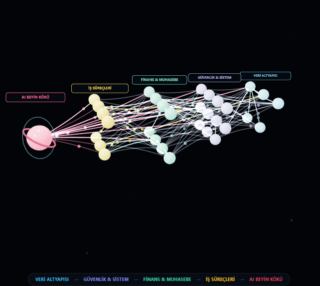
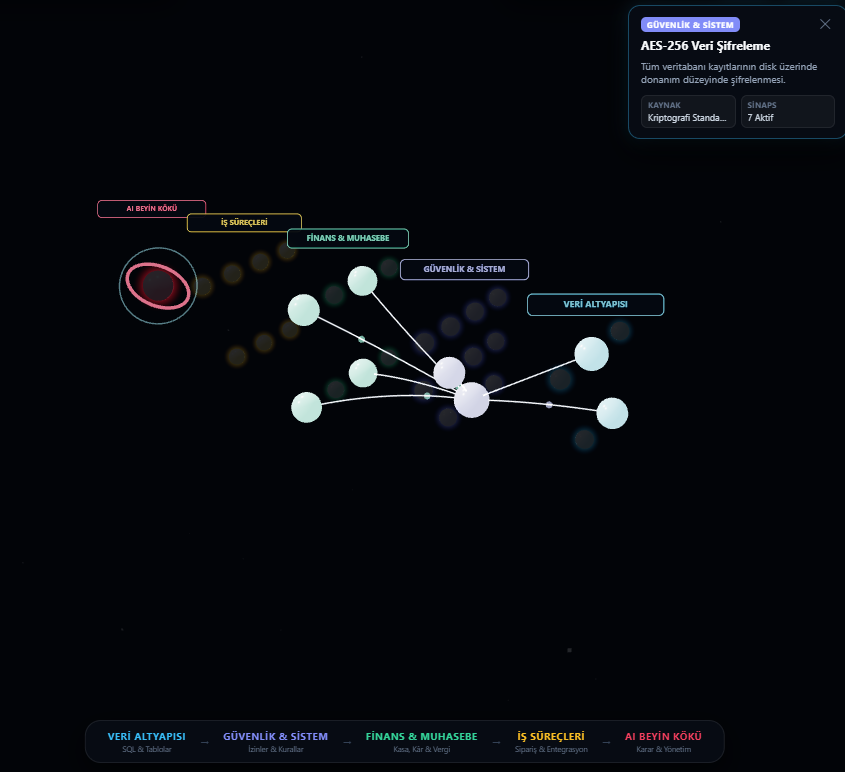
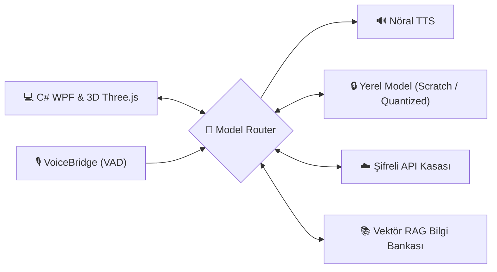
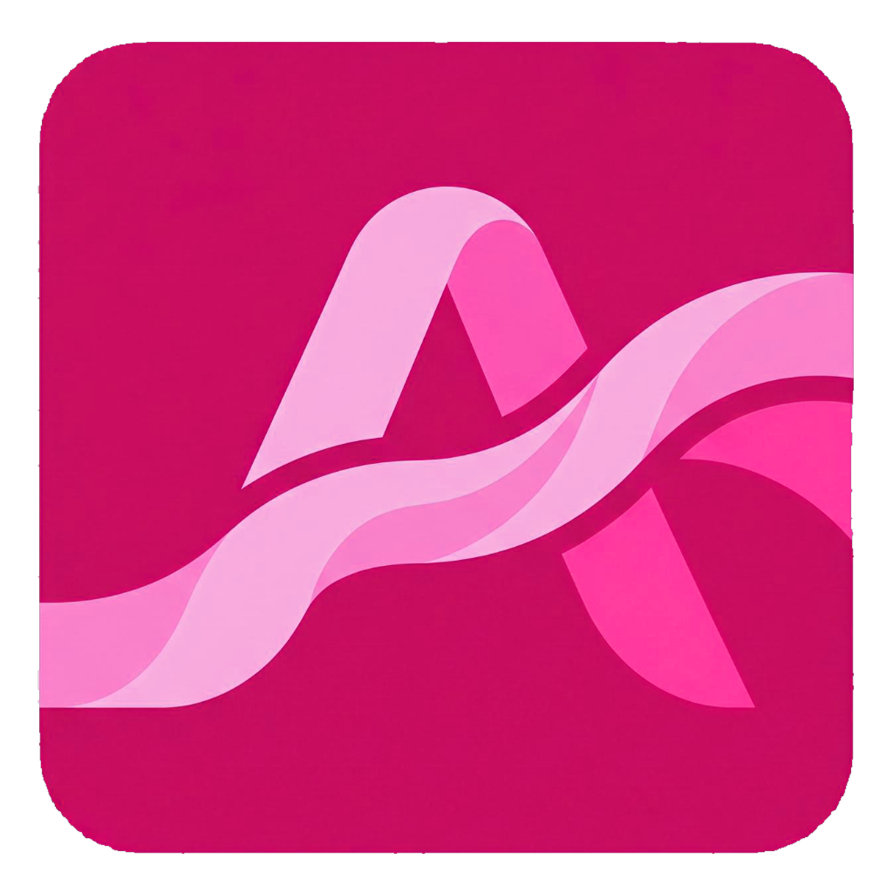
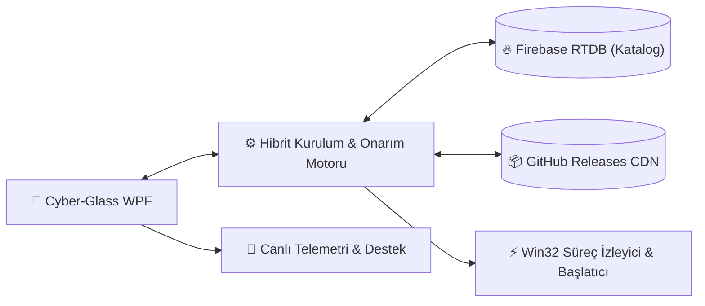
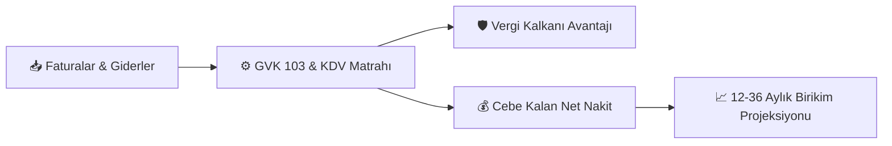
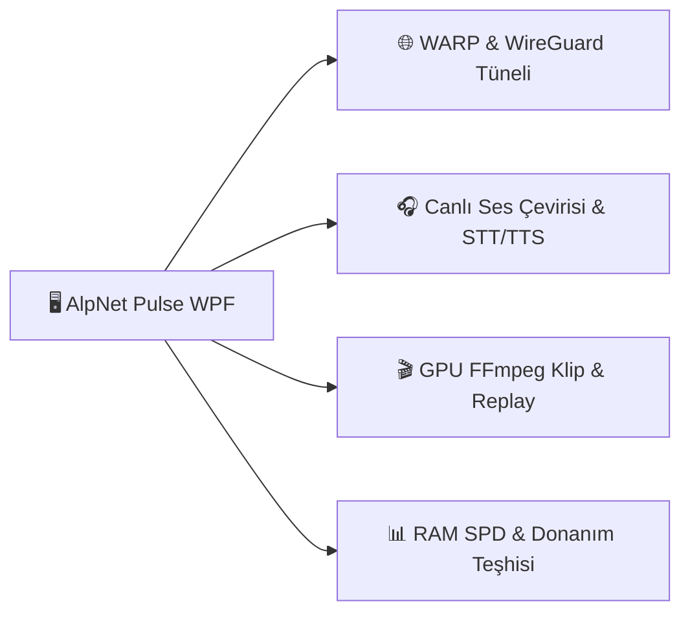
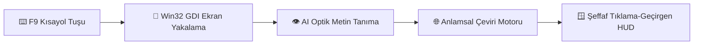

# 👋 Merhaba, Ben Alphan Kılıçaslan

  

  
  
  
  

---

## 👨‍💻 Programcılık Vizyonum & Yaklaşımım

Ben pratik, sahada çalışan, donanımın ve işletim sisteminin dilinden anlayan bir **Bilgisayar Programcısıyım**.

Geliştirdiğim projelerde teorik yaklaşımlardan ziyade; **doğrudan performansa odaklanan, düşük seviyeli API'leri (Win32, ASIO, WMI, Donanım sürücüleri) kullanan, otonom yapay zeka modelleri geliştiren ve gerçek hayat problemlerine çözüm üreten** yazılımlar inşa ediyorum.

> [!IMPORTANT]
> Projelerimin tamamı tescilli yazılımlar ve fikri mülkiyet (IP) korumalı masaüstü sistemleri olduğu için kaynak kodları kapalı tutulmaktadır. Derlenmiş resmi sürümleri (`.exe`, `.Setup.exe`, `.zip`) doğrudan GitHub Releases üzerinden ve **AlpTogether** ekosistem istemcisinden dağıtılmaktadır. Aşağıda bu sistemlerin **derinlemesine çalışma mantığı, özellikleri, mimari şemaları ve görsel topolojileri** yer almaktadır.

---

## 🛠️ Yetkinlikler & Teknoloji Yığını

  

* **Diller & Ortamlar:** C# (.NET 9 / WPF), Python, C/C++, TypeScript, JavaScript, Lua.
* **Yapay Zeka & Agentic Sistemler:** AlphaGravity Otonom Çekirdeği, Yerel Model Çalıştırma (Quantized / Local LLM), Çoklu Model Orkestrasyonu, Vektör RAG Bilgi Bankası, Gerçek Zamanlı Ses Köprüsü (VoiceBridge), 3D Semantik Çizge Görselleştirme, AI OCR Optik Tanıma.
* **Masaüstü & Sistem Programlama:** Windows Presentation Foundation (WPF), Win32 API (P/Invoke, WS_EX_LAYERED, Click-through), WebView2 (Modern Web Entegrasyonu), FFmpeg Interop, NAudio / ASIO.
* **Ağ & Dağıtım Altyapısı:** Cloudflare WARP & WireGuard Tünelleme, Native Wi-Fi API, Donanım Telemetrisi (RAM SPD, WMI, Sürücü Analizi), Firebase Realtime DB, GitHub CDN Hibrit Güncelleme Protokolü.
* **Finansal Modelleme:** GVK 103 Kademeli Vergi Matrah Simülasyonu, KDV Mahsuplaşma Algoritmaları, Dinamik Nakit Akış Tahmini.

---

## 🌟 Alp Ekosistemi & Öne Çıkan Projeler

| Proje | Tanım | Teknoloji | Durum / İndirme |
| :--- | :--- | :--- | :---: |
| 🌸 **[AlpTogether](https://github.com/alphankilicaslan/AlpTogether)** | Birleşik İstemci, Hibrit Kurulum, Onarım & Telemetri | C# (.NET 9 WPF) |  |
| 🧠 **[AlphaGravity](https://github.com/alphankilicaslan/AlphaGravity)** | Kurumsal Yapay Zeka, RAG, 3B Bilgi Topolojisi & Ses | C# WPF + Three.js |  |
| 💰 **[AlpFinans](https://github.com/alphankilicaslan/AlpFinans)** | Kişisel Finans, GVK 103 Vergi Simülatörü & Fatura | C# WPF + SQLite |  |
| 🌐 **[AlpNet Pulse](https://github.com/alphankilicaslan/AlpNet)** | Ağ Hızlandırma, WARP Tüneli & Canlı Ses Çevirisi | C# WPF + Python + WARP |  |
| ⚡ **[AlpRust+](https://github.com/alphankilicaslan/AlpRustPlus)** | Rust+ Akıllı Cihaz, Kamera & Raid Alarm Merkezi | C# WPF + WebSocket |  |
| 🔤 **[AlpLingo](https://github.com/alphankilicaslan/AlpLingo)** | Gerçek Zamanlı AI Ekran & Oyun Çevirici (OCR Overlay) | C# / Win32 + Python OCR |  |

---

## 🔬 Kapsamlı Sistem & Mimari İncelemeleri

---

### 🧠 1. AlphaGravity — Otonom Kurumsal Yapay Zeka & 3D Bilgi Zekası Platformu (Amiral Gemisi)

  
  
  
  
  
  

  <table width="80%">
    <tr>
      <td align="center" width="50%">
        
         
        <b>Şekil 1: Canlı 3D Semantik Sinir Topolojisi</b> Tüm kurumsal katmanların canlı bağlantı matrisi
      </td>
      <td align="center" width="50%">
        
         
        <b>Şekil 2: İnteraktif Düğüm & Sinaps İncelemesi</b> AES-256 disk şifreleme ve sinaps analizi
      </td>
    </tr>
  </table>

**AlphaGravity**, işletmelerin ve bağımsız araştırmacıların hassas verilerini dış dünyadan tamamen izole ederek işleyen, yerel LLM inference motorunu, iki yönlü sesli asistanı ve 3 boyutlu interaktif bilgi haritasını bir araya getiren amiral gemisi masaüstü yapay zeka istasyonudur.

<b>📐 AlphaGravity Sistem Mimari Akış Şeması (Genişletmek için tıklayın)</b>

 

#### 🔬 AlphaGravity'nin Öne Çıkan Mimari Yetenekleri:
1. **Dinamik 3D Semantik Sinir Topolojisi & Katman Hiyerarşisi:**
   * Yapay zekanın öğrendiği tüm kavramlar, kurumsal veriler ve iş süreçleri 5 temel katmanda canlı sinaps bağlantılarıyla görselleştirilir:
     * **Veri Altyapısı:** SQL, tablolar ve yapılandırılmamış veri kaynakları.
     * **Güvenlik & Sistem:** İzinler, kurallar ve **AES-256 donanım düzeyinde disk şifreleme** standartları (Şekil 2'de detaylandırılmıştır).
     * **Finans & Muhasebe:** Kasa hareketleri, kâr marjları ve vergi yükümlülükleri.
     * **İş Süreçleri:** Sipariş yönetimi, operasyonel iş akışları ve servis entegrasyonları.
     * **AI Beyin Kökü:** Tüm katmanlardan beslenen karar destek ve otonom yönetim merkezi.
2. **VoiceBridge — Gerçek Zamanlı Ses Köprüsü:**
   * Tuşlara basmadan, konuşma bittiği anı algılayan VAD (Voice Activity Detection) algoritmalarıyla yapay zekaya sesli girdi sağlayan ve yanıtı anlık nöral ses senteziyle geri seslendiren düşük gecikmeli döngü.
3. **İzole / Çevrimdışı Çalışma (Air-Gapped Modu):**
   * Gizli şirket verilerinin internete sızmasını engellemek amacıyla tamamen yerel donanımda çalışan modeller ile sıfır veri sızıntısı garantisi.
4. **Kriptografik Güvenlik Kasası (Local Secret Vault):**
   * Harici servis anahtarları işletim sisteminin kriptografik API'leri kullanılarak şifrelenir; telemetri veya log kaydı dışarı aktarılmaz.
5. **Kararlı Kontrol Noktaları (Checkpoint & Rollback Mimarisi):**
   * Bilgi tabanı üzerinde yapılan tüm güncellemeler ve model hafızası anlık olarak snapshot'lanabilir; tek tıkla eski kararlı duruma (`GERI_YUKLE_CHECKPOINT`) dönülebilir.

---

### 🕹️ 2. AlpTogether — Alp Ekosistemi Birleşik Uygulama İstemcisi, Hibrit Kurulum & Onarım Merkezi

  
  
  
  
  

  

**AlpTogether**, tüm Alphan Kılıçaslan masaüstü yazılımlarını (AlpNet Pulse, AlpFinans, AlphaGravity, AlpRust+, AlpLingo) tek bir merkezden yöneten, Steam ve Riot Games istemcileri mimarisinde geliştirilmiş hibrit bir istemci ve ekosistem launcher'ıdır. Uygulamalar istemcinin içine gömülmez; merkezi bulut kataloğundan dinamik olarak çekilir, doğrulanır, tek tıkla kurulur, güncellenir ve onarılır.

<b>📐 AlpTogether Sistem Mimari Akış Şeması (Genişletmek için tıklayın)</b>

 

#### 🔍 AlpTogether'ın Çözdüğü Problemler ve Özellikleri:
1. **Merkezi Dağıtım & Bağımsız Modüler Mimari:**
   * Uygulamaların devasa boyutları tek bir pakete hapsedilmez. İstemci, Steam benzeri bağımsız indirme ve yükleme kuyruğuyla her yazılımı kendi izole dizinine kurar ve yönetir.
2. **Hibrit Kurulum Teknolojisi (Doğrudan Dosya + Setup Otomasyonu):**
   * Kendi MSI veya InnoSetup yükleyicisi olan uygulamalarda arka plan sessiz kurulum parametrelerini (`/auto`, `/quiet`) çalıştırır; bağımsız çalışan tekil dosyalarda ise doğrudan binary ve dll bağımlılıklarını kurup yapılandırır.
3. **Tek Tıkla Dosya Bütünlüğü Doğrulama & Otomatik Onarım:**
   * Uygulamanın herhangi bir dosyası silindiğinde veya bozulduğunda katalogdaki orijinal SHA/MD5 ve boyut matrisiyle dosyaları tarar, yalnızca eksik/bozuk parçaları yeniden indirerek sıfırdan kurulum zahmetini ortadan kaldırır.
4. **Anlık Hata Raporlama & Doğrudan İletişim Masası (Telemetry & Helpdesk):**
   * Kullanıcılar herhangi bir uygulamada sorun yaşadığında, tek tıkla sistem tanı verileriyle birlikte geliştiriciye hata raporu gönderebilir.
5. **Akıcı Pembe Siber-Cam (Pink Cyber-Glass) Fluent Arayüz:**
   * 60 FPS donanım hızlandırmalı WPF mimarisi, neon pembe vurgular (`#FF2E93`, `#FF5CAA`), dinamik arama, filtreleme ve gerçek zamanlı disk alanı göstergeleriyle üst düzey bir kullanıcı deneyimi sağlar.

---

### 💰 3. AlpFinans — Gelir/Gider Analitiği, GVK 103 Vergi Simülatörü & Net Kâr Hesaplayıcı

  
  
  
  
  

**AlpFinans**, şahıs şirketleri, serbest çalışan programcılar ve KOBİ'ler için geliştirilmiş; yalnızca geçmiş harcamaları tutmakla kalmayıp Türkiye Vergi Mevzuatına göre **gelecekteki vergi yükünü ve gerçek net kârı kuruşu kuruşuna hesaplayan** gelişmiş bir finansal karar destek sistemidir.

<b>📐 AlpFinans Sistem Mimari Akış Şeması (Genişletmek için tıklayın)</b>

 

#### 🔍 AlpFinans'ın Çözdüğü Problemler ve Özellikleri:
1. **"Ay Sonunda Cebime Ne Kalacak?" Sorusuna Kesin Yanıt:**
   * Birçok yazılımcı ve işletme brüt ciro ile eline geçen parayı karıştırır. AlpFinans; KDV'yi, gelir vergisi dilimlerini ve işletme giderlerini birbirinden ayrıştırarak kullanıcının şahsi cebine kalan net harcanabilir tutarı net olarak raporlar.
2. **Gerçek Zamanlı GVK 103 Gelir Vergisi Dilim Simülatörü:**
   * Kazanç arttıkça %15'ten başlayıp %20, %27, %35 ve %40 dilimlerine geçen kademeli gelir vergisi baremlerini anlık simüle eder. Fatura kesilmeden önce vergi dilimi atlamasının maliyetini gösterir.
3. **Genç Girişimci İstisnası Desteği:**
   * Mevzuatta yer alan genç girişimci matrah muafiyetini (230.000 TL) tek tıkla hesaba katarak yeni girişimcilerin gerçek nakit akışını planlamasını sağlar.
4. **Vergi Kalkanı (Tax Shield) Analitiği:**
   * Yapılan bir giderin (örneğin donanım, ofis ya da yazılım aboneliği) şirkete sağladığı KDV mahsubu ve gelir vergisi indirim avantajını hesaplayarak harcamanın gerçek maliyetini ortaya koyar.
5. **Sıfır Bulut Bağımlılığı & %100 Finansal Gizlilik:**
   * Şirketin ve geliştiricinin hassas finansal tabloları kesinlikle üçüncü taraf bulut veritabanlarına gönderilmez; tamamen yerel cihazda şifreli veri tabanında tutulur.

---

### 🌐 4. AlpNet & AlpNet Pulse — Gelişmiş Ağ Tünelleme, Gerçek Zamanlı Ses Çevirisi & Donanım Telemetrisi

  
  
  
  
  

**AlpNet Pulse**, oyuncular, canlı yayıncılar ve ileri düzey bilgisayar kullanıcıları için geliştirilmiş çok fonksiyonlu bir sistem merkezidir. Yalnızca standart bir teleometri aracı değil; ağ tünelleme, anlık sesli çeviri, anlık oyun klibi yakalama ve donanım kontrolünü tek çatı altında birleştiren entegre bir masaüstü yazılımıdır.

<b>📐 AlpNet Pulse Sistem Mimari Akış Şeması (Genişletmek için tıklayın)</b>

 

#### 🔍 AlpNet Pulse'ın Çözdüğü Problemler ve Özellikleri:
1. **Akıllı Ağ Yönlendirme & WARP Tünelleme (WarpManager & SplitWire):**
   * İnternet trafiğini optimize eden, sansür ve rota gecikmelerini aşmak için Cloudflare WARP ve WireGuard tünellerini masaüstünden tek tıkla başlatan ve yöneten tünelleme entegrasyonu.
   * `NativeWifi` modülüyle çevre Wi-Fi ağlarını donanım seviyesinde tarama ve sinyal kalitesini haritalandırma.
2. **Canlı İki Yönlü Ses İşleme & Anlık Çeviri (VoiceTranslation Pipeline):**
   * Oyun veya görüşmeler sırasında gelen yabancı sesleri mikrofon/kulaklık düzeyinde yakalayan, düşük gecikmeli Python çeviri motoruna ileten ve çeviriyi kullanıcıya doğrudan nöral sesle dinleten tam entegre ses köprüsü.
   * Çok kanallı surround sesleri bozulma olmadan stereo kulaklıklara indirgeyen `SurroundToStereoProvider` ses matrisi.
3. **Sistem Kaynaklarını Yormayan Arka Plan Replay / Klip Motoru (FFmpegManager):**
   * GPU hızlandırmalı FFmpeg motoru sayesinde oyunda veya ekranda yaşanan son saniyeleri (Instant Replay) sistem performansını düşürmeden RAM/Disk tamponunda tutma ve global kısayol tuşuyla anında klip olarak kaydetme.
   * Kaydedilen klipleri doğrudan uygulama içindeki özel video oynatıcıda (`VideoPlayerWindow`) inceleme imkanı.
4. **Düşük Seviyeli Donanım Teşhis Kütüphanesi:**
   * WMI, RAM SPD (Timing & Bellek çipi üretici bilgileri) ve Disk denetleyicisi seviyesinde donanım okuma.
5. **Güvenlik, Lisanslama & Obfuscation:**
   * Donanım parmak izine (HWID) kilitli lisans doğrulama sistemi (`AlpNet.Keygen`), MSI yükleyicisi ve `Obfuscar` ile tersine mühendisliğe karşı korunan binary mimarisi.

---

### 🔤 5. AlpLingo — Gerçek Zamanlı Yapay Zeka Ekran & Oyun Çevirici (AI OCR Overlay)

  
  
  
  
  

**AlpLingo**, Türkçe dil desteği olmayan oyunlar, teknik yazılımlar ve yabancı dildeki masaüstü uygulamaları için geliştirilmiş; ekrandaki seçili bölgeyi veya tam ekranı gerçek zamanlı optik karakter tanıma (OCR) ile okuyup yapay zeka ile anında çeviren ve oyun deneyimini kesintiye uğratmadan şeffaf tıklama-geçirgen bir HUD katmanıyla ekrana yansıtan yardımcı çeviri istasyonudur.

<b>📐 AlpLingo Sistem Mimari Akış Şeması (Genişletmek için tıklayın)</b>

 

#### 🔍 AlpLingo'nun Çözdüğü Problemler ve Özellikleri:
1. **Oyun İçi Tıklama-Geçirgen (Click-Through) HUD Katmanı:**
   * Win32 pencere bayrakları (`WS_EX_TRANSPARENT`, `WS_EX_LAYERED`) kullanılarak oyun esnasında fare tıklamalarının altyazıya takılmadan doğrudan oyuna geçmesini sağlar; altyazı açıkken dahi oyun kesintiye uğramaz.
2. **Yüksek Hızlı Optik Karakter Tanıma (OCR):**
   * Oyun fontlarını, karmaşık arka planları ve düşük kontrastlı metinleri doğru okumak için özel görüntü ön işleme filtreleri uygular.
3. **Bölgesel veya Tam Ekran Çeviri Desteği:**
   * Kullanıcı tek bir kısayol tuşuyla dilerse ekranın belirli bir diyalog penceresini dilerse tüm ekranı seçip anında çevirebilir.
4. **Bağımsız Masaüstü Yürütülebilir Paketi (`AlpLingo.exe`):**
   * Python veya ek kütüphane kurulumu gerektirmeyen, bağımsız çalışabilir native C# / Win32 paketleme yapısıyla tek tıkla çalışır.

---

### 🎮 6. AlpRust+ — Gelişmiş Rust Companion & Masaüstü Otomasyonu

  
  
  
  

**AlpRust+**, Rust oyununun resmi Rust+ API ve WebSocket protokolü üzerinden oyun içi akıllı anahtarlar, alarmlar, SAM siteleri ve CCTV güvenlik kameraları ile doğrudan masaüstünden çift yönlü haberleşen gelişmiş bir oyuncu otomasyon merkezidir. Baskın (raid) alarmlarını anında masaüstü bildirimi olarak iletir ve tek tuşla üs savunma mekanizmalarını tetikler.

---

  <i>"Bir bilgisayar programcısının asıl gücü; teoride kalmayıp çalışan, hızlı ve gerçek problemleri çözen sistemler inşa edebilmesidir."</i>

